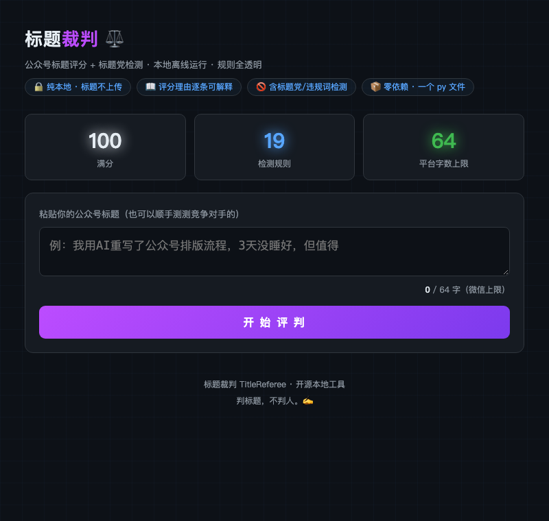

# 标题裁判 TitleReferee ⚖️

**本地离线的公众号标题评分 + 标题党检测工具。** 粘贴标题 → 3 秒出可解释评分报告。



[](LICENSE)
[](https://www.python.org/)
[](app.py)

## 为什么是它

市面上的标题评分工具全是**联网 SaaS 或浏览器插件**：标题要上传到别人服务器、评分是黑盒、还按月收费。

标题裁判反过来：

- **🔒 纯本地离线** —— 标题永不出你的电脑（无任何网络请求，代码可审计，一个文件读完）
- **📖 逐条可解释** —— 每一分扣在哪里、命中了什么词、为什么扣，全部摊开
- **🚫 标题党检测** —— 内置「震惊体」「不看后悔」「99%的人不知道」等微信平台整治句式，高危直接亮红
- **📦 零依赖** —— 纯 Python 标准库，`python3 app.py` 一条命令跑起来

## 快速开始

```bash
git clone https://github.com/tomlen045/title-referee.git
cd title-referee
python3 app.py
# 打开 http://127.0.0.1:8670
```

无 pip install、无配置文件、无 API Key。

## 评分怎么算（全透明）

**100 分起步：**

| 维度 | 规则示例 |
|---|---|
| ➖ 标题党/违规词 | 「震惊」类夸张情绪 -15 · 「转发这/不转不是」道德绑架 -15 · 「99%的人不知道」虚构统计 -12 · 绝对化用语（最/第一/100%）-8 …（重复命中累计扣分，高危叠加再罚） |
| ➕ 正向信号 | 具体数字 +6 · 干货词（实测/复盘/保姆级）+6 · 评测信号 +6 · 第一人称亲历 +3 |
| ➖ 长度修正 | >64 字超微信上限 -20 · >30 字移动端截断风险 -4 · <8 字信息量不足 -6 |
| ➕ 结构信号 | 【】栏目标签 +3 · 分隔符 +2 |

**等级**：S(≥85) 可直接发布 · A(≥72) 微调 · B(≥60) 平庸 · C(≥45) 建议重写 · D(<45) 标题党炸弹必须重写

每个样本报告附带**改写方向建议**与「题文一致」自检提醒——判标题，也提醒你别骗读者。

## 适合谁

- 公众号 / 头条 / 小红书创作者：发之前 3 秒自检，避开限流词
- 新媒体团队：统一标题口径，新人不用背规则
- 竞品分析：顺手把同行的爆款标题丢进来，看它为什么能打

## 隐私承诺

**标题数据只落盘在你自己的 `data/` 目录**（已列入 .gitignore，永远不会进 git）。代码无任何上报、无遥测、无第三方请求——`grep -r "http" app.py` 可以亲自验。

## 路线图

- [ ] 逐平台字数规范（头条/小红书/知乎各自的截断线）
- [ ] 违禁词库扩充为可编辑的 JSON 规则包
- [ ] A/B 对比模式（两个标题并排评分）
- [ ] 英文标题支持

## License

MIT — 随便用，改完最好告诉我一声。
