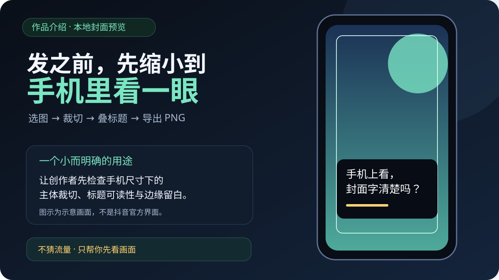
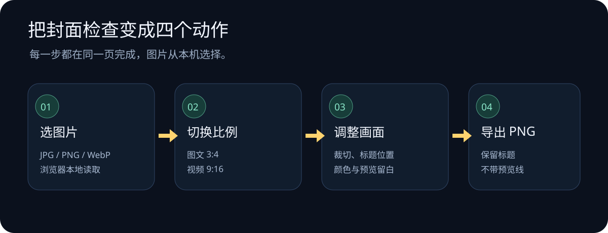

# 标题裁判 TitleReferee ⚖️

**一个本地运行的创作者自检工具：先检查标题规则，再预览封面构图。**

标题评分和封面预览都使用可读、可修改的本地实现。评分结果是规则提示，不代表平台审核或流量预测；封面图片在浏览器中处理，不上传到第三方服务。

📖 [阅读封面实验室完整介绍和操作图](docs/story/cover-lab-story.md) · [打开封面预览页面源码](static/cover-lab.html)

## 这个项目解决什么问题

创作前的标题检查不必是黑盒打分；一张封面也可以先缩小到手机尺寸看一遍。标题裁判把这些小检查放在一个本地网页项目里：粘贴标题查看逐条规则说明，或打开封面实验室调整画布比例、裁切、标题和留白。

## 两个小工具

### 标题裁判

- 用本地规则给标题提供参考分数，并展示触发的正向与负向提示。
- 按当前规则集检查长度、标题结构、常见夸张表达等信号。
- 可下载本地评分报告；规则本身可以从代码中阅读。
- 评分不代表平台审核结果，也不能证明某个词会导致限流或违规。

### 封面实验室

- 选择本地 JPG、PNG 或 WebP 图片，切换图文 3:4 / 视频 9:16 画布。
- 调整缩放、横向和纵向裁切、标题位置与颜色、预览留白。
- 导出带标题的 PNG；预览边界线和遮罩不会进入文件。
- 输入图片由浏览器本地处理，不通过图片上传接口发送到服务端。

## 快速开始

    git clone https://github.com/tomlen045/title-referee.git
    cd title-referee
    python3 app.py

打开 http://127.0.0.1:8670 使用标题检查；进入 /cover 使用封面实验室。也可以直接在浏览器中打开 static/cover-lab.html 体验封面预览页。

不需要 pip 安装、API Key 或第三方图片服务。

## 评分规则

评分以 100 分为起点，按当前代码中的规则做加减分，并展示命中说明。规则会变化，结果只适合作为编辑前的自检清单。它不会判断文章内容是否真实，也不保证标题与正文匹配；发布前仍需创作者自行核对。

## 隐私与边界

- 标题评分页面通过本地服务处理输入；封面图片在浏览器中读取并使用 Canvas 预览和导出。
- 封面页没有图片上传接口、遥测或第三方字体服务。
- 封面预览不是抖音官方裁切模拟。设备、版本和发布页界面可能造成不同遮挡。
- 标题对比度提示是粗略图像取样，不是 WCAG 合规结论。
- 项目不预测播放量、点赞、收藏或涨粉效果。

完整功能介绍、操作图和来源说明见 [封面实验室作品介绍](docs/story/cover-lab-story.md)。

## License

MIT License.
