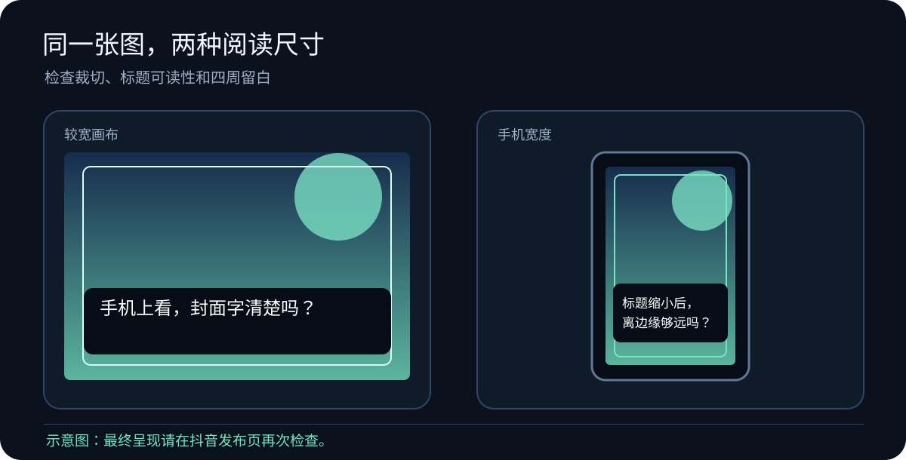
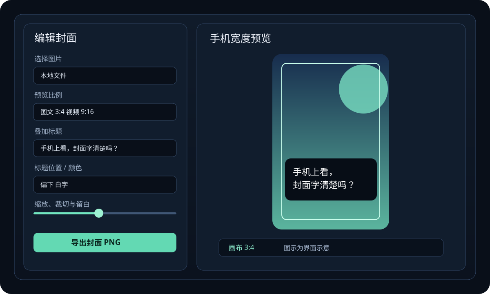
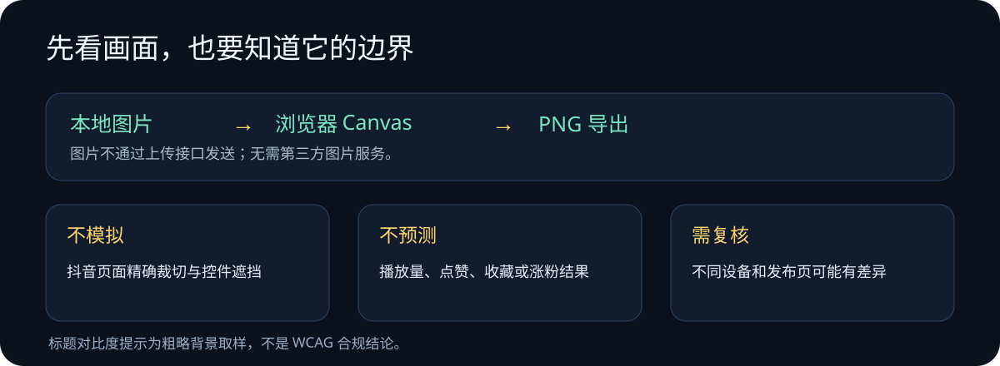

# 封面实验室：发出去之前，先缩小到手机里看一眼

**作品介绍 · 2026-10-23**

一张封面在电脑上看着挺完整，到了手机尺寸，标题可能显得拥挤，主体也可能落在裁切边缘附近。封面实验室把这一步预览变成一个简单流程：选图、切比例、调构图和标题、导出 PNG。

它不替你决定发什么内容，只帮你在发布前多看一遍画面。

## 为什么做这个小工具

剪辑软件很适合完成制作，但有时只是想快速检查一张封面，就得重新打开完整工程。这个小工具把常用的封面调整放在一个本地网页里，方便先看图片裁切、标题位置和四周留白。

这不是一套“爆款公式”。标题是否清楚、主体是否合适，仍然需要创作者结合主题和发布页自己判断。

## 从图片到导出，只做四步

1. 从本机选择 JPG、PNG 或 WebP 图片。
2. 在图文 3:4 和视频 9:16 之间切换预览画布。
3. 调整缩放、横向或纵向裁切、标题文字、位置、颜色和预览留白。
4. 导出 PNG。标题会进入图片，预览用的虚线和遮罩不会导出。

## 为什么图片不上传

图片文件由浏览器本地读取，预览和合成都使用 Canvas 完成。这个页面没有图片上传接口，也不依赖第三方图片服务；导出的文件由浏览器生成。

工具接受 JPG、PNG、WebP，单张图片限制为 15 MB，并限制最大像素量，避免过大的图片占用过多内存。

## 它能做什么，也不能做什么

- 能让你在两种常见画布比例里预览同一张图，并自己调整构图和标题。
- 能导出带标题的 PNG，预览边界线不会写入成品。
- 不能模拟抖音发布页的精确裁切、按钮遮挡或每种手机的显示效果。
- 不能预测播放量、点赞、收藏或涨粉结果。
- 标题对比提示只做粗略的背景取样，不等于无障碍合规检查。

所以更稳妥的使用方式是：先在本工具调整，再把导出的图放进抖音发布页复核。

## 本地运行

    git clone https://github.com/tomlen045/title-referee.git
    cd title-referee
    python3 app.py

然后打开 http://127.0.0.1:8670/cover。也可以直接用浏览器打开 static/cover-lab.html。

## 设计说明和来源

这组图文以用户提供的公众号文章作为表达形式参考，采用“有内容、有图片、有介绍”的结构。文章链接在制作时无法读取正文，因此没有对其做具体内容拆解，也没有复用其文字、图片、代码或界面。工具与配图为本次独立实现；核对日期：2026-10-23。

配图中的示例封面是工具内置的示意画面，不代表抖音官方界面或真实发布效果。文字由 AI 辅助整理，功能描述以仓库代码为准。
